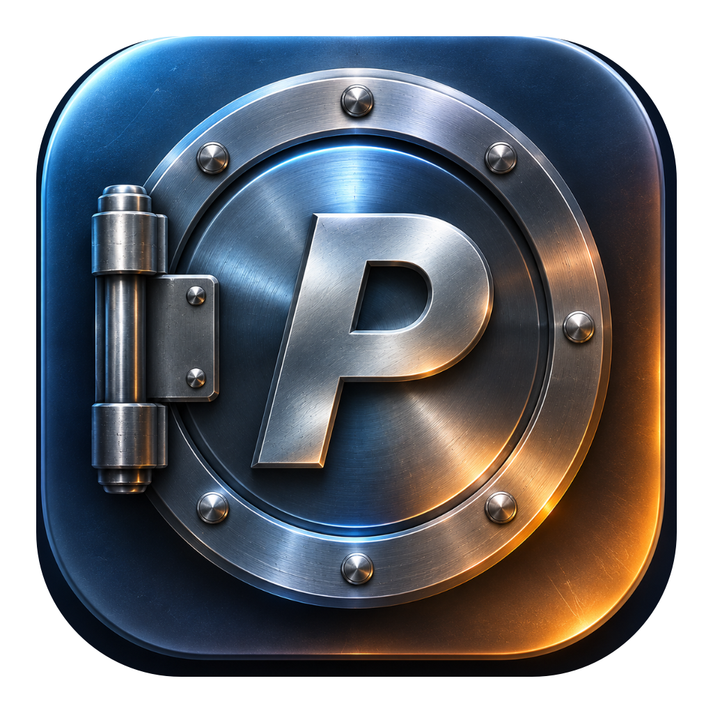

<div align="center">
  
  <h1>PasteVault</h1>
  <p><b>Smart clipboard manager, screenshot editor, offline OCR, password vault with timer, and snippet manager for macOS.</b></p>

  <p>
    <a href="../../releases/latest"></a>
    
    
    
  </p>

  <p>
    <a href="README.md">🇷🇺 Русский</a> &nbsp;|&nbsp; <b>🇬🇧 English</b> &nbsp;|&nbsp; <a href="../../releases/latest">⬇️ Download v1.0.0 (.dmg)</a>
  </p>
</div>

---

### ✨ Features

* **Smart Clipboard with Search Highlighting** — Instant full-text search powered by SQLite FTS5 with real-time colored match highlighting in card text; filter by content types (Text, Code, Links, Images, Colors `#HEX`, Passwords, Pinned); pinning (`Pin`), text editing, smart transformations (JSON, Base64, case convert, whitespace trim), and instant auto-paste into active windows.
* **Built-in Screenshot & Image Editor** — Full-featured markup for copied images and screenshots in one click: arrows, rectangles, ellipses, text annotations, highlighter, blur/pixelation for secrets, step counters (`1, 2, 3`), magnifier loupe, cropping, zoom, and hotkey support.
* **Offline Photo OCR** — Instant offline text extraction in English and Russian from screenshots and images via native Apple Vision framework without sending anything to the cloud.
* **Password Vault, Secret Detector & Self-Destruct Timer** — Automatic detection of passwords, API keys, and tokens with bullet masking (`••••`), auto-delete timer (10 sec to 6 min) with pause and stop controls, plus a built-in cryptographically secure password & passphrase generator (CSPRNG) with entropy calculation.
* **Quick Snippets** — Categorized storage for text templates, signatures, and commands with `Pin` protection against accidental bulk clearing, search highlighting, and dynamic tags (`{{date}}`, `{{time}}`, and `{{clipboard}}`).
* **Backup & Data Transfer (`.pastevaultbackup`)** — Flexible selective export and duplicate-free import: backup all clipboard history or pinned items only, all or pinned snippets, app settings, global shortcuts, and the Blacklist.
* **10 Themes, 6 Fonts & Audio-Taptic Feedback** — 5 *Liquid Glass* themes (with window opacity controls), 5 solid matte themes, 6 Cyrillic-ready fonts, and delicate audio/taptic click feedback.
* **100% Offline & Private (Zero-Telemetry)** — All clipboard history, passwords, local SQLite database, and OCR text recognition are processed strictly on your Mac. The only network call is an optional GitHub Releases update check on user request or when enabled in settings. Incognito mode and a configurable app Blacklist are included.

---

### 📦 Installation

1. Download **`PasteVault_v1.0.0_Universal.dmg`** from [**Releases**](../../releases/latest) (runs natively on Apple Silicon M1–M4 & Intel), open the disk image, and drag **`Paste Vault.app`** into **`Applications`**.
2. On first launch, bypass the macOS Gatekeeper prompt using either method:
   * **Method 1 (macOS UI):** Try opening `Paste Vault.app` → click "Done" on the Gatekeeper dialog → open **System Settings → Privacy & Security**, scroll down, and click **"Open Anyway"**.
   * **Method 2 (1-second Terminal command):**
     ```bash
     xattr -cr "/Applications/Paste Vault.app" && open "/Applications/Paste Vault.app"
     ```
3. Enable **Paste Vault** in *System Settings → Privacy & Security → Accessibility* to allow auto-pasting.

---

### ⌨️ Shortcuts

#### General Shortcuts
| Shortcut | Action |
| :--- | :--- |
| **`⌘ + Shift + V`** *(or `⌥ + Space`)* | Toggle PasteVault window *(customizable in Settings)* |
| **`⏎` (Enter)** | Paste selected item into active window |
| **`Shift + ⏎`** | Paste as Plain Text (strip formatting) |
| **`⌥ + 1` … `⌥ + 9`** | Quick-paste item #1…9 |
| **`⌥ + P`** | Pin / unpin selected card |

#### Screenshot Editor Tools
When annotating images, the following keyboard shortcuts are supported:
* `A` — Arrow &nbsp;|&nbsp; `R` — Rectangle &nbsp;|&nbsp; `T` — Text &nbsp;|&nbsp; `B` — Blur / Pixelate &nbsp;|&nbsp; `N` — Step Counter (`1, 2, 3`) &nbsp;|&nbsp; `M` — Magnifier &nbsp;|&nbsp; `⌘ + Z` — Undo &nbsp;|&nbsp; `⌘ + S` — Save

---

### 💻 System Requirements

* **macOS:** 13.0 (Ventura) or later
* **Architecture:** Universal Binary (`arm64` Apple Silicon M1–M4 + `x86_64` Intel)
* **UI Language:** English / Russian (switchable in Settings)
* **Local Storage:** `~/Library/Application Support/PasteVault/` (100% offline, SQLite)

<div align="center">
  <sub>Made with ❤️ for macOS • <b>PasteVault v1.0.0</b></sub>
</div>
