[Русский](README.md) · [English](README.en.md) · License: [MIT](LICENSE)

<p align="center">
  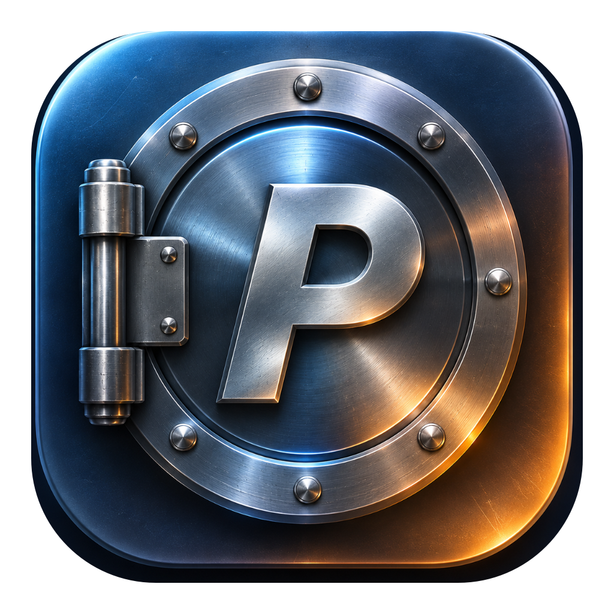
</p>

<h1 align="center">PasteVault v1.1.3</h1>

<p align="center">
  <strong>Fast, private, and completely local clipboard manager, screenshot editor, 3D snippets deck, and cryptographic password generator for macOS.</strong>
</p>

<p align="center">
  <em>100% On-Mac Storage • Zero Cloud, Analytics, or Telemetry • SQLite FTS5 • Apple Vision OCR • Encrypted PVENC2 Backups</em><br />
  <a href="https://github.com/GarbGhost/PasteVault/releases/download/v1.1.3/PasteVault_v1.1.3_Universal.dmg">Download PasteVault_v1.1.3_Universal.dmg (v1.1.3)</a>
</p>

<p align="center">
  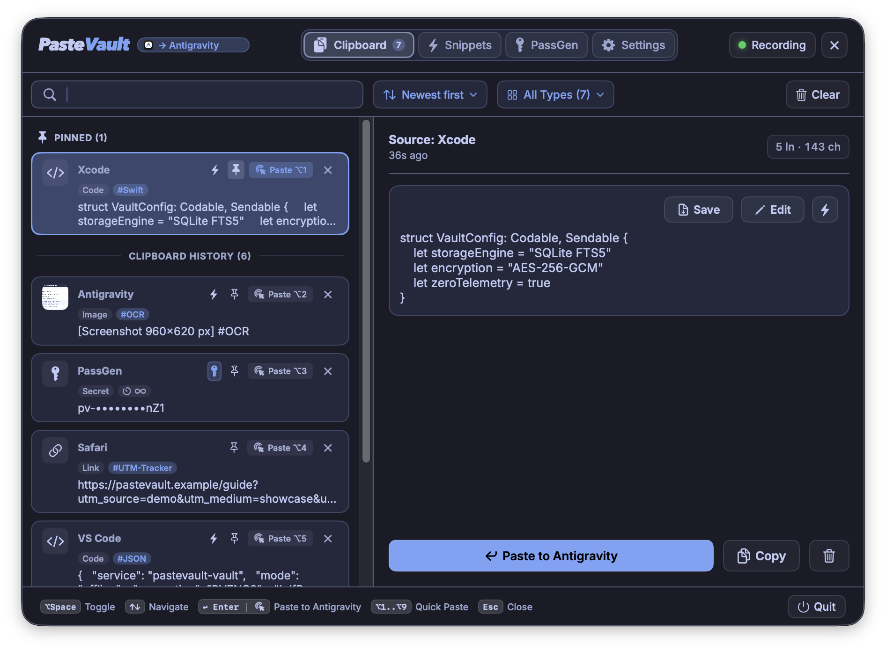
</p>

---

## Table of Contents

- [1. Clipboard History, FTS5 Search, OCR & Export](#1-clipboard-history-fts5-search-ocr--export)
- [2. Built-in Screenshot Editor](#2-built-in-screenshot-editor)
- [3. Snippets 2.0: 3D Card Deck, Macros & Categories](#3-snippets-20-3d-card-deck-macros--categories)
- [4. Password Generator & Secret Protection](#4-password-generator--secret-protection)
- [5. Settings, Themes, Backups & Privacy](#5-settings-themes-backups--privacy)
- [6. Installation & Compatibility](#6-installation--compatibility)
- [7. Visual Tour](#7-visual-tour)

---

## 1. Clipboard History, FTS5 Search, OCR & Export

PasteVault continuously captures everything you copy on macOS, classifies items automatically, and organizes them inside a clean two-pane workspace:

- **Instant SQLite FTS5 Full-Text Search** with real-time match highlighting across copied text, source app names, and OCR text extracted from screenshots.
- **Smart Auto-Classification & Badges:** detects source code (`#Swift`, `#JSON`, etc.), links (`#UTM-Tracker`), hex colors (`#HEX`), screenshots (`#OCR`), secrets, files, and plain notes.
- **Pinning & Filtering:** keep essential items at the top (`PINNED`), sort chronologically, or filter by content category.
- **Offline Apple Vision OCR:** extracts readable text from copied screenshots locally with zero network requests, complete with one-click copy and paste actions for recognized text.
- **Inspector Utilities:** strip UTM tracking parameters from URLs, format or minify JSON payloads, edit text inline, and view live character/word/line counts.
- **Card File Export:** export text and code entries to `.txt, .docx, .md, .conf, .json, .swift, .py, .sh, .js` with automatic recommended format selection.

---

## 2. Built-in Screenshot Editor

Open any screenshot or image in the built-in vector and pixel annotation studio directly inside the panel:

- **Straight & Curved Arrows** with configurable stroke width and curvature handle.
- **Geometric Shapes:** rounded rectangle, rectangle, ellipse, and line tools.
- **Text & Callouts:** add text annotations and pointer callouts using locally bundled UI and mono fonts.
- **Translucent Highlighter & Step Counters:** emphasize key lines cleanly or drop numbered badges (`1, 2, 3...`).
- **Fine Pixelation (6px) & Retouch Brush:** redact sensitive URLs, tokens, and private details before sharing.
- **Zoom, Pan & Undo History:** smooth zoom controls, multi-step undo/redo, PNG file export, or save annotated copy back to the clipboard.

---

## 3. Snippets 2.0: 3D Card Deck, Macros & Categories

Manage reusable templates, commands, replies, and AI prompts in an interactive **3D Card Deck**:

- **Fluid Deck Navigation:** browse cards with scroll gestures, arrow keys, or the side index rail, pin top snippets, and paste directly into the active app.
- **Dynamic Macros:** expand live tokens on copy or paste — `{{date}}`, `{{time}}`, `{{weekday}}`, `{{iso}}`, `{{app}}`, `{{user}}`, `{{uuid}}`.
- **Custom Categories:** create, rename, and organize categories with custom icons and per-category filtering.
- **Image Attachments:** attach reference screenshots or thumbnails to snippets with instant preview support.

---

## 4. Password Generator & Secret Protection

- **Cryptographic CSPRNG Generator:** Powered by Apple's `SecRandomCopyBytes` to produce high-entropy character passwords (8–48 chars with configurable symbols, digits, and uppercase letters) and memorable passphrases with live bit-entropy readouts.
- **Automatic Secret Detection:** flags passwords, API keys, and tokens automatically and masks sensitive values in the list and inspector (`pv-••••••••nZ1`).
- **Auto-Purge Timer:** configure countdown timers per secret item with start, pause, resume, and automatic removal from both clipboard history and the system pasteboard.
- **Incognito Mode & App Blacklist:** pause capture in one click from the top bar or exclude password managers and sensitive apps permanently.

---

## 5. Settings, Themes, Backups & Privacy

- **Themes & Typography:** choose from 5 Glass themes (`Obsidian`, `Midnight`, `Emerald`, `Amber`, `Frost`) and 5 Matte themes (`Nordic Slate`, `Tokyo Night`, `Catppuccin Mocha`, `Solarized Paper`, `Carbon Brutalist`), fine-tune window opacity, and pick from 10 bundled offline fonts (`Inter`, `JetBrains Mono`, and more).
- **Encrypted `PVENC2` Backups:** export and restore clipboard history, snippets, categories, and preferences locally using password-protected `PVENC2` encryption (AES-256-GCM + PBKDF2 200k iterations) or plain JSON with Merge and Replace modes.
- **Memory & Storage Controls:** toggle saving for files, images, and text, configure history capacity limits (100–1,000 items), and monitor local disk usage.
- **Keyboard Workflow:** Shortcuts — fast keyboard control and customizable hotkeys for opening the panel, navigation, and pasting.
- **Bilingual & Private by Design:** instant switching between English and Russian interfaces, optional on-demand GitHub release checks, and zero telemetry.

---

## 6. Installation & Compatibility

Runs on macOS 14 and up, on Apple Silicon and Intel (Universal Binary).

- **Prebuilt Installer (v1.1.3):** download [PasteVault_v1.1.3_Universal.dmg](https://github.com/GarbGhost/PasteVault/releases/download/v1.1.3/PasteVault_v1.1.3_Universal.dmg) and drag `Paste Vault.app` into `/Applications`.

### Build from Source

```bash
git clone https://github.com/Alex-A-Kuznetsov/Project_PasteVault.git
cd Project_PasteVault
swift build -c release
```

To enable instant auto-pasting into the frontmost macOS app, grant **Accessibility** permission in **System Settings -> Privacy & Security** (accessible directly from **Settings -> System** inside PasteVault).

---

## 7. Visual Tour

<table>
  <tr>
    <td align="center" width="50%">
      <br />
      <sub><strong>1. Clipboard History</strong> — pinned cards, smart badges, and two-pane inspector</sub>
    </td>
    <td align="center" width="50%">
      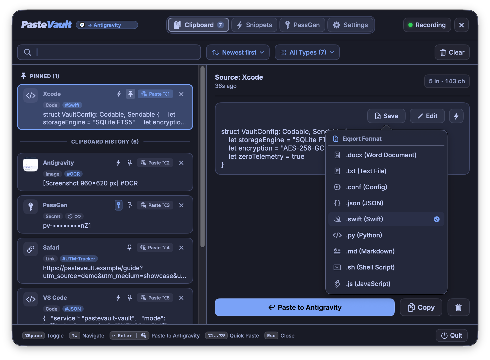<br />
      <sub><strong>2. Export in 9 Formats</strong> — <code>.txt</code>, <code>.docx</code>, <code>.md</code>, <code>.conf</code>, <code>.json</code>, <code>.swift</code>, <code>.py</code>, <code>.sh</code>, <code>.js</code></sub>
    </td>
  </tr>
  <tr>
    <td align="center" width="50%">
      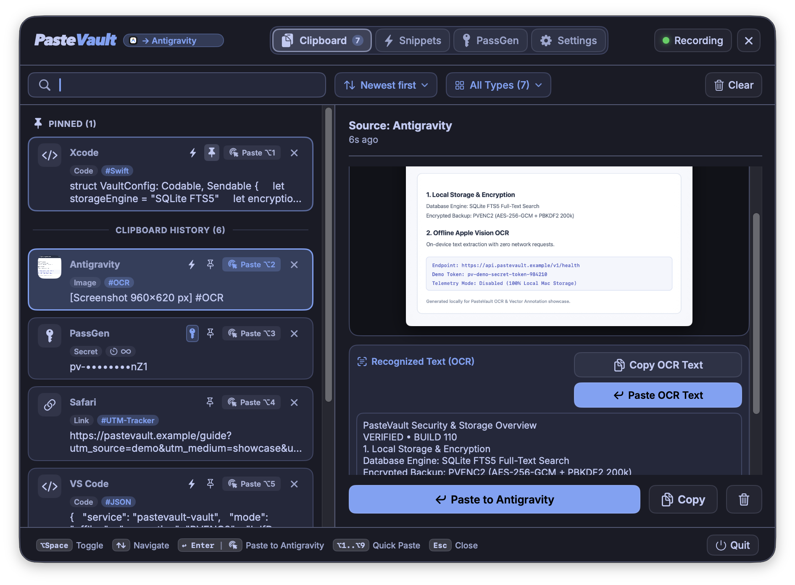<br />
      <sub><strong>3. Offline Apple Vision OCR</strong> — on-device screenshot text extraction</sub>
    </td>
    <td align="center" width="50%">
      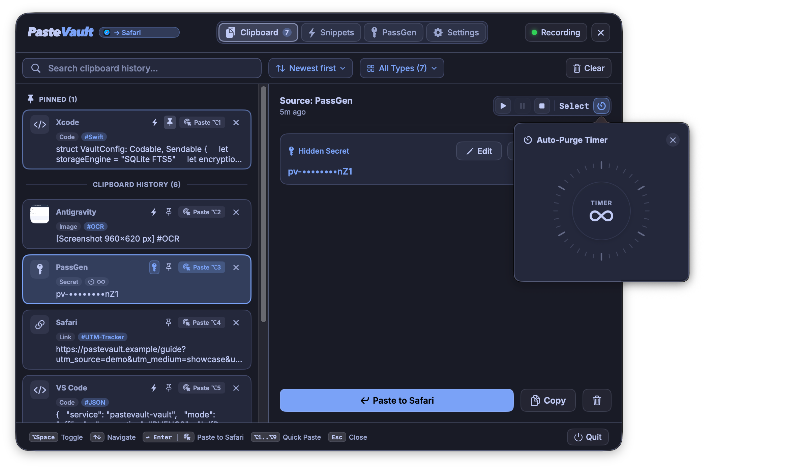<br />
      <sub><strong>4. Secret Masking & Timer</strong> — sensitive masking and auto-purge countdown</sub>
    </td>
  </tr>
  <tr>
    <td align="center" width="50%">
      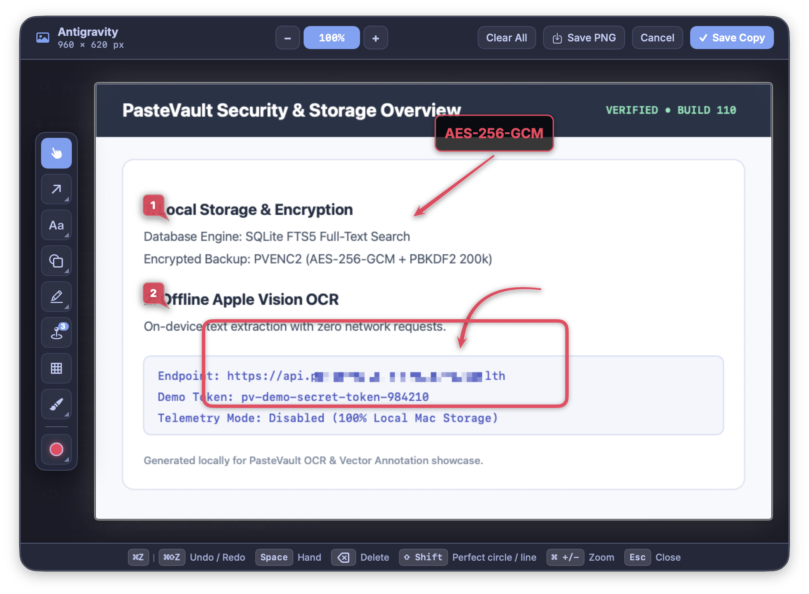<br />
      <sub><strong>5. Built-in Screenshot Editor</strong> — arrows, callouts, step markers, and 6px pixelation</sub>
    </td>
    <td align="center" width="50%">
      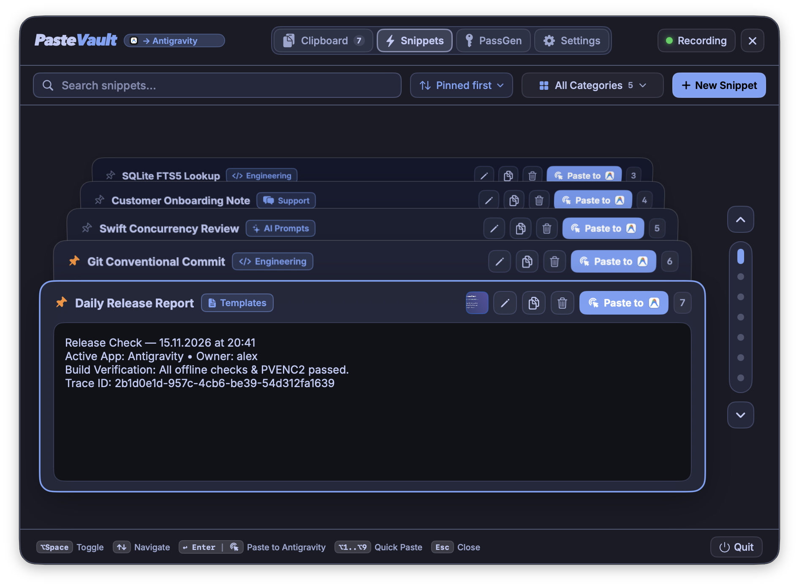<br />
      <sub><strong>6. Snippets 2.0 (3D Deck)</strong> — live <code>{{date}}</code>, <code>{{app}}</code>, <code>{{user}}</code> macros and attachments</sub>
    </td>
  </tr>
  <tr>
    <td align="center" width="50%">
      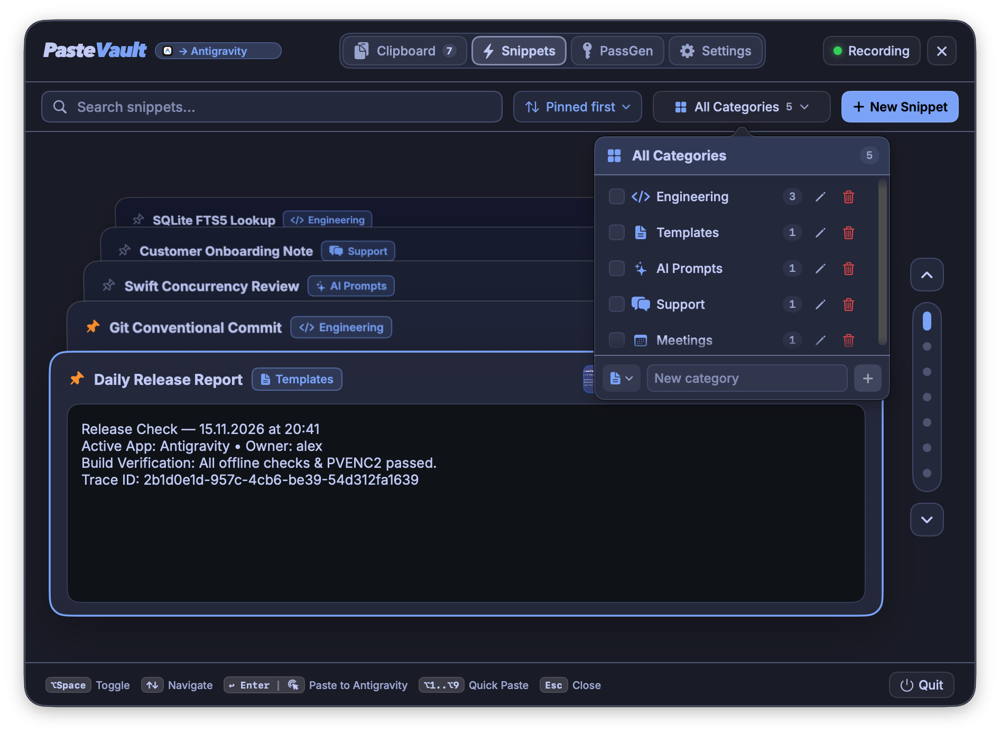<br />
      <sub><strong>7. Custom Categories</strong> — icon filtering, counts, and instant management</sub>
    </td>
    <td align="center" width="50%">
      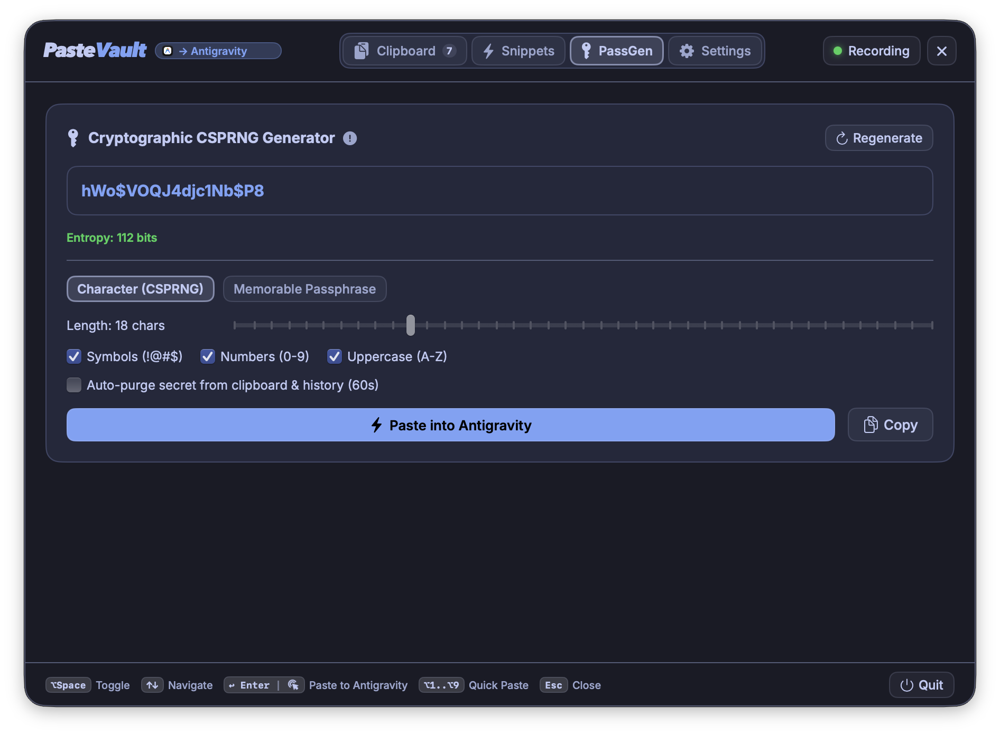<br />
      <sub><strong>8. Cryptographic Password Generator</strong> — bit-entropy meter and memorable passphrases</sub>
    </td>
  </tr>
  <tr>
    <td align="center" width="50%">
      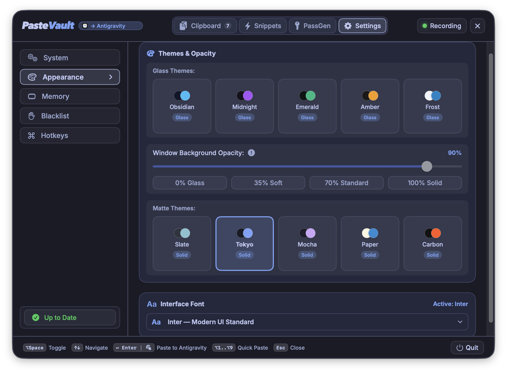<br />
      <sub><strong>9. Appearance & Typography</strong> — Glass/Matte themes, opacity slider, and local fonts</sub>
    </td>
    <td align="center" width="50%">
      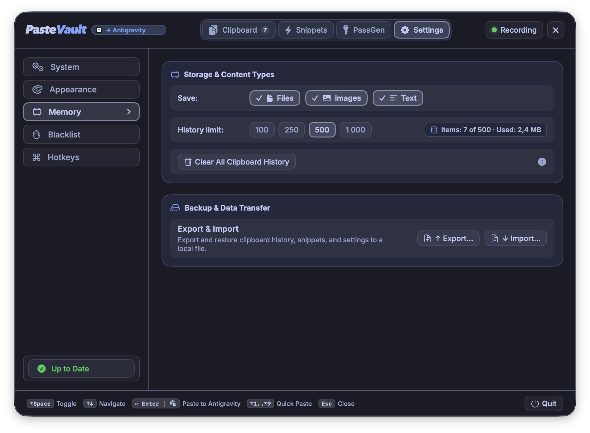<br />
      <sub><strong>10. Memory & Encrypted Backups</strong> — history limits and local export/import</sub>
    </td>
  </tr>
</table>
