[Русский](README.md) · [English](README.en.md) · Лицензия: [MIT](LICENSE)

<p align="center">
  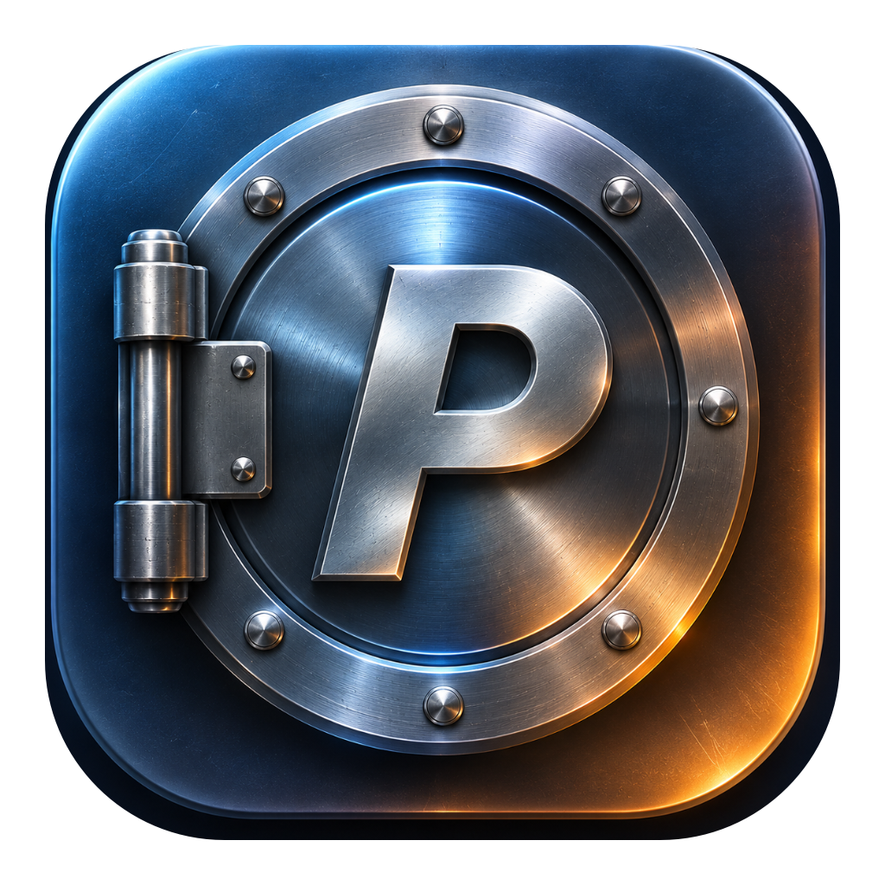
</p>

<h1 align="center">PasteVault v1.1.4</h1>

<p align="center">
  <strong>Быстрый, приватный и полностью локальный менеджер буфера обмена, редактор скриншотов, 3D-сниппеты и криптографический генератор паролей для macOS.</strong>
</p>

<p align="center">
  <em>100% хранение на вашем Mac • Без облака, аналитики и телеметрии • SQLite FTS5 • Apple Vision OCR • Зашифрованный бэкап PVENC2</em><br />
  <a href="https://github.com/GarbGhost/PasteVault/releases/download/v1.1.4/PasteVault_v1.1.4_Universal.dmg">Скачать PasteVault_v1.1.4_Universal.dmg (v1.1.4)</a>
</p>

<p align="center">
  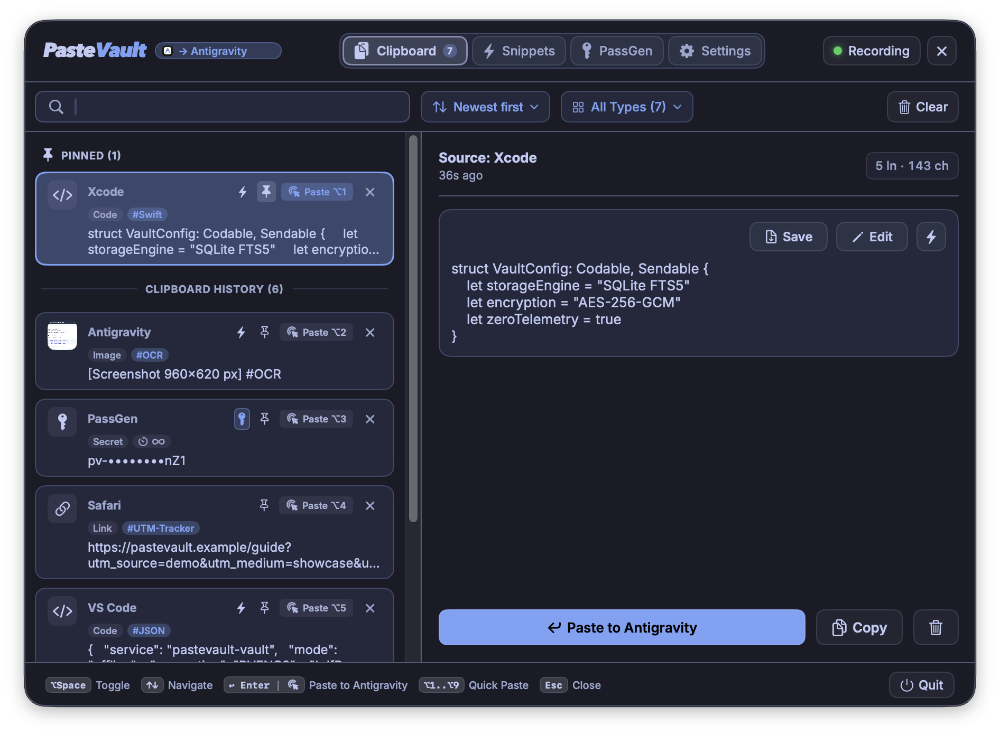
</p>

---

## Содержание

- [1. История буфера обмена, поиск FTS5, OCR и экспорт](#1-история-буфера-обмена-поиск-fts5-ocr-и-экспорт)
- [2. Встроенный редактор скриншотов](#2-встроенный-редактор-скриншотов)
- [3. Сниппеты 2.0: 3D-колода карточек, макросы и категории](#3-сниппеты-20-3d-колода-карточек-макросы-и-категории)
- [4. Генератор паролей и защита секретов](#4-генератор-паролей-и-защита-секретов)
- [5. Настройки, темы, резервные копии и приватность](#5-настройки-темы-резервные-копии-и-приватность)
- [6. Установка и совместимость](#6-установка-и-совместимость)
- [7. Галерея интерфейса](#7-галерея-интерфейса)

---

## 1. История буфера обмена, поиск FTS5, OCR и экспорт

PasteVault непрерывно фиксирует всё, что вы копируете в macOS, автоматически определяет тип содержимого и раскладывает записи по удобной двухпанельной витрине:

- **Молниеносный полнотекстовый поиск SQLite FTS5** с подсветкой совпадений в реальном времени по тексту, названию исходного приложения и распознанному тексту на скриншотах.
- **Автоклассификация и теги:** код (`#Swift`, `#JSON` и др.), ссылки (`#UTM-Tracker`), цвета (`#HEX`), скриншоты (`#OCR`), пароли и секреты, файлы и заметки.
- **Закрепление и фильтрация:** закрепляйте важные записи вверху списка (`PINNED`), сортируйте по времени или фильтруйте по типу содержимого.
- **Офлайн-OCR на базе Apple Vision:** автоматическое извлечение текста с любого скопированного скриншота локально на устройстве — с кнопками мгновенного копирования и вставки распознанного текста.
- **Инструменты работы с данными в один клик:** очистка UTM-меток у ссылок, форматирование и минификация JSON, быстрое редактирование текста прямо в инспекторе, счётчик строк, слов и символов.
- **Экспорт карточки в файл:** сохранение текстовых и кодовых записей в `.txt, .docx, .html, .md, .conf, .json, .swift, .py, .sh, .js` с умной подсказкой подходящего формата.

---

## 2. Встроенный редактор скриншотов

Любое изображение или скриншот из истории буфера можно сразу открыть во встроенном векторно-растровом редакторе без сторонних программ:

- **Стрелки (прямая и изогнутая)** с настраиваемой толщиной линии и гибкой кривизной.
- **Геометрические фигуры:** скруглённый прямоугольник, прямоугольник, эллипс и прямая линия.
- **Текст и выноски:** добавление текстовых комментариев и выносок со стрелкой с выбором локального шрифта.
- **Полупрозрачный маркер и шаги-маячки:** выделение строк текста маркером и автоматическая нумерация шагов (`1, 2, 3...`).
- **Мелкая пикселизация (6px) и кисть ретуши:** аккуратное скрытие токенов, ключей, адресов и конфиденциальных фрагментов перед публикацией.
- **Масштабирование и история правок:** зум, панорамирование, отмена/повтор, сохранение в PNG или мгновенное копирование размеченного скриншота в буфер.

---

## 3. Сниппеты 2.0: 3D-колода карточек, макросы и категории

Раздел сниппетов оформлен как интерактивная **3D-колода карточек** для хранения готовых шаблонов ответов, команд, промптов и фрагментов кода:

- **Удобная навигация по колоде:** перелистывание скроллом, клавиатурой или боковой лентой карточек, закрепление важных шаблонов и мгновенная вставка в активное приложение.
- **Динамические макросы:** автоматическая подстановка актуальных значений в момент копирования или вставки — `{{date}}`, `{{time}}`, `{{weekday}}`, `{{iso}}`, `{{app}}`, `{{user}}`, `{{uuid}}`.
- **Пользовательские категории:** организация фрагментов по категориям с иконками, счётчиками, созданием, редактированием и фильтрацией.
- **Вложения изображений:** возможность прикрепить скриншот или картинку к сниппету и просматривать её в предпросмотре.

---

## 4. Генератор паролей и защита секретов

- **Криптостойкий локальный генератор (CSPRNG):** использует системный генератор Apple `SecRandomCopyBytes` для создания случайных паролей (8–48 символов, спецсимволы, цифры, верхний регистр) и мнемонических парольных фраз с расчётом энтропии в битах.
- **Умный детектор секретов:** автоматически распознаёт пароли, токены и API-ключи, маскируя их на карточках и в инспекторе (`pv-••••••••nZ1`).
- **Настраиваемый таймер самоуничтожения:** точный контроль времени жизни секрета с запуском, паузой, сбросом и автоматической очисткой как из истории PasteVault, так и из системного буфера обмена.
- **Режим «Инкогнито» и чёрный список:** приостановка записи в один клик в верхней панели и исключение выбранных приложений (например, менеджеров паролей) из перехвата.

---

## 5. Настройки, темы, резервные копии и приватность

- **Темы оформления и типографика:** 5 стеклянных тем (`Obsidian`, `Midnight`, `Emerald`, `Amber`, `Frost`), 5 матовых тем (`Nordic Slate`, `Tokyo Night`, `Catppuccin Mocha`, `Solarized Paper`, `Carbon Brutalist`), плавный ползунок прозрачности фона окна и 10 встроенных офлайн-шрифтов (`Inter`, `JetBrains Mono` и др.).
- **Шифрованное резервное копирование (`PVENC2`):** локальный экспорт и импорт истории, сниппетов, категорий и настроек в файл формата `PVENC2` (AES-256-GCM + PBKDF2 200k итераций) или JSON с режимами слияния и полной замены.
- **Управление памятью:** выбор сохраняемых типов (файлы, изображения, текст), лимит истории (100–1000 записей) и контроль занимаемого места на диске.
- **Управление с клавиатуры:** Шорткаты — быстрое управление с клавиатуры и настраиваемые горячие клавиши для вызова окна, навигации и вставки.
- **Двуязычность и прозрачность:** встроенное переключение между русским и английским интерфейсом, проверка актуальных сборок на GitHub по запросу и полное отсутствие телеметрии.

---

## 6. Установка и совместимость

Работает на macOS 14 и новее, на процессорах Apple Silicon (серия M) и Intel (Universal Binary).

- **Готовый установщик (v1.1.4):** скачать [PasteVault_v1.1.4_Universal.dmg](https://github.com/GarbGhost/PasteVault/releases/download/v1.1.4/PasteVault_v1.1.4_Universal.dmg) и перенести `Paste Vault.app` в `/Applications`.

### Быстрый старт из исходников

```bash
git clone https://github.com/Alex-A-Kuznetsov/Project_PasteVault.git
cd Project_PasteVault
swift build -c release
```

Для мгновенной автовставки содержимого в активное окно macOS предоставьте приложению разрешение **Универсальный доступ (Accessibility)** в **Системных настройках -> Конфиденциальность и безопасность** (доступен удобный переход прямо из раздела **Настройки -> Система** внутри PasteVault).

---

## 7. Галерея интерфейса

<table>
  <tr>
    <td align="center" width="50%">
      <br />
      <sub><strong>1. История буфера обмена</strong> — закреплённые карточки, теги типов и инспектор</sub>
    </td>
    <td align="center" width="50%">
      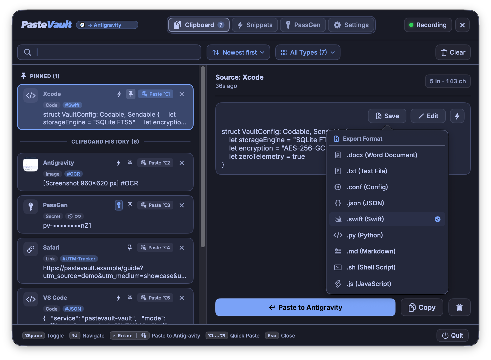<br />
      <sub><strong>2. Экспорт в 9 форматов</strong> — <code>.txt</code>, <code>.docx</code>, <code>.md</code>, <code>.conf</code>, <code>.json</code>, <code>.swift</code>, <code>.py</code>, <code>.sh</code>, <code>.js</code></sub>
    </td>
  </tr>
  <tr>
    <td align="center" width="50%">
      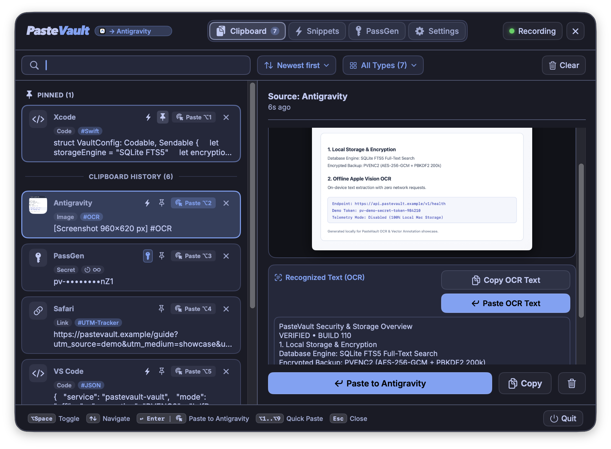<br />
      <sub><strong>3. Офлайн Apple Vision OCR</strong> — извлечение текста со скриншота без сети</sub>
    </td>
    <td align="center" width="50%">
      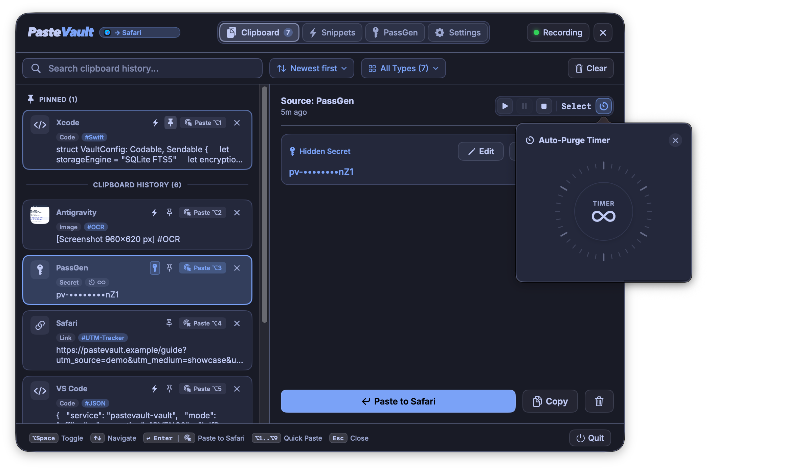<br />
      <sub><strong>4. Защита секретов и таймер</strong> — маскирование ключей и автоочистка</sub>
    </td>
  </tr>
  <tr>
    <td align="center" width="50%">
      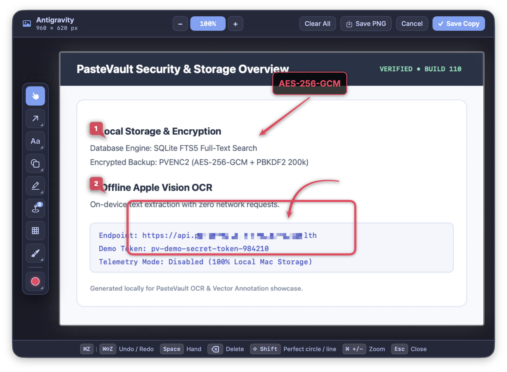<br />
      <sub><strong>5. Встроенный редактор скриншотов</strong> — стрелки, выноски, шаги и пикселизация</sub>
    </td>
    <td align="center" width="50%">
      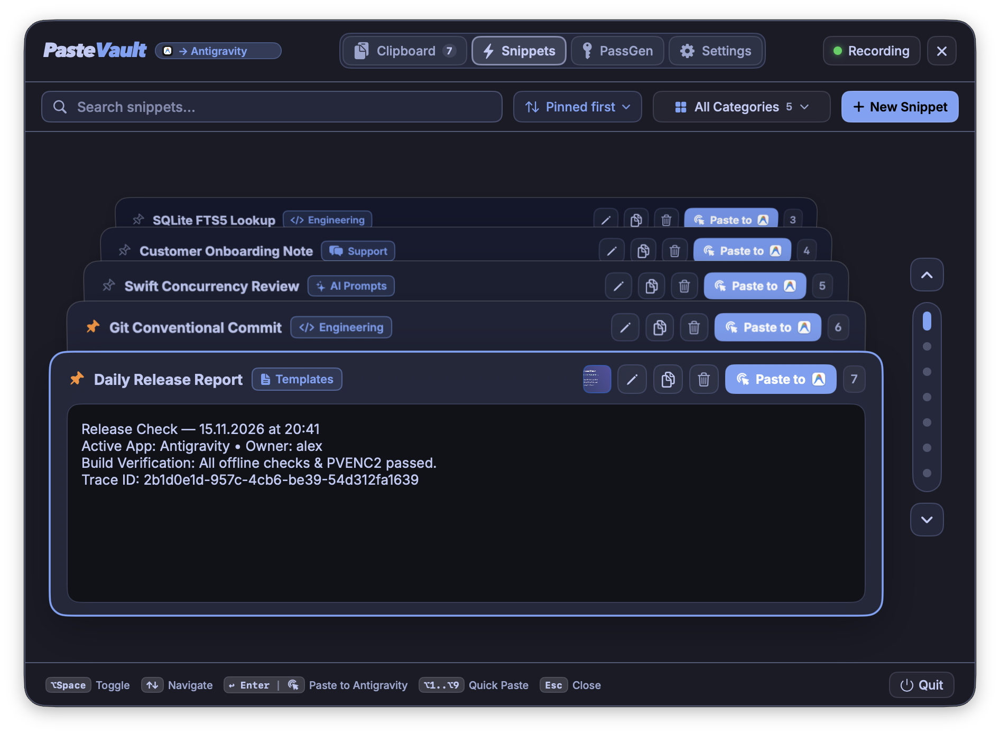<br />
      <sub><strong>6. Сниппеты 2.0 (3D-колода)</strong> — макросы <code>{{date}}</code>, <code>{{app}}</code>, <code>{{user}}</code> и превью</sub>
    </td>
  </tr>
  <tr>
    <td align="center" width="50%">
      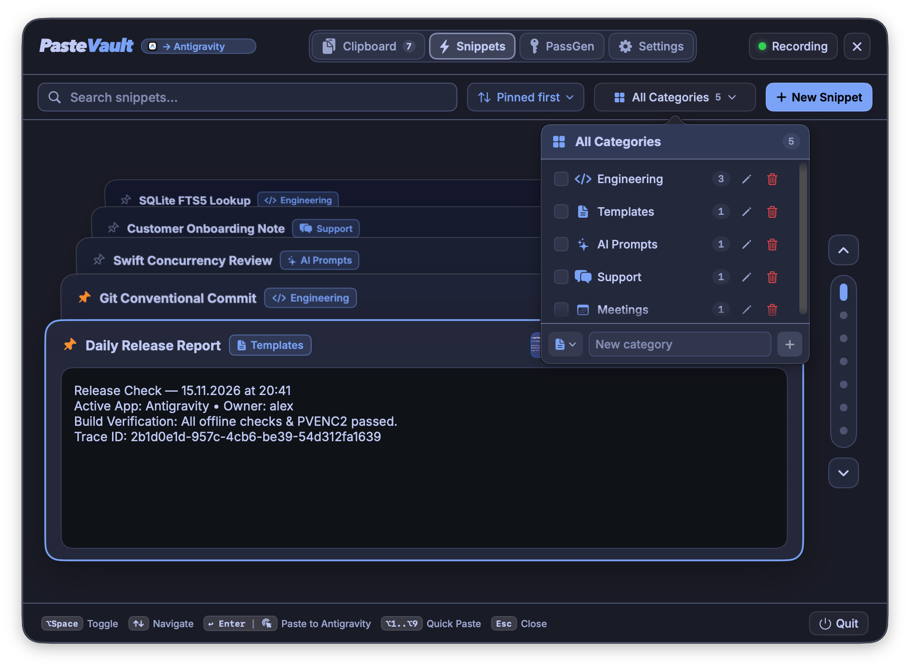<br />
      <sub><strong>7. Категории сниппетов</strong> — фильтрация, иконки и быстрое управление</sub>
    </td>
    <td align="center" width="50%">
      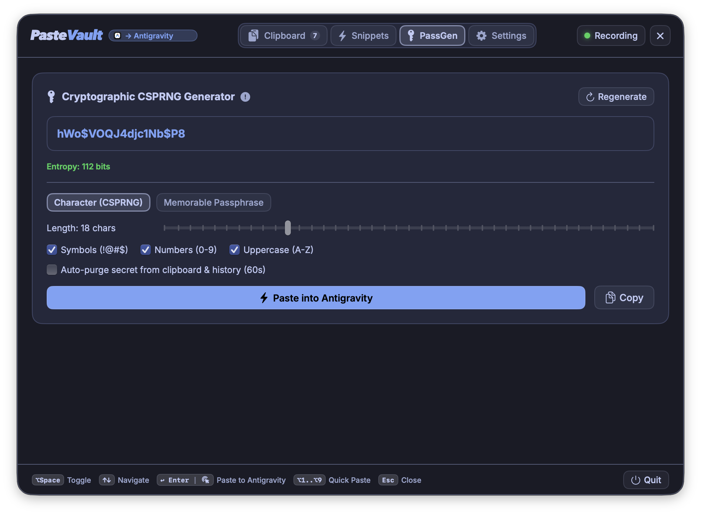<br />
      <sub><strong>8. Генератор паролей (CSPRNG)</strong> — расчёт энтропии и мнемонические фразы</sub>
    </td>
  </tr>
  <tr>
    <td align="center" width="50%">
      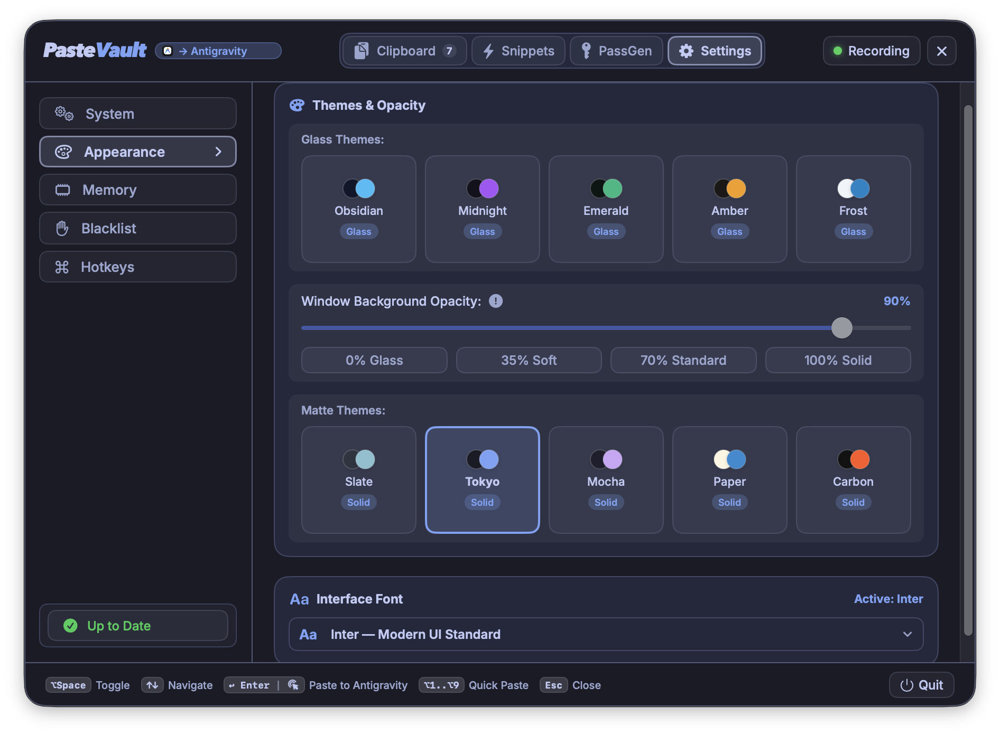<br />
      <sub><strong>9. Оформление и шрифты</strong> — стеклянные/матовые темы, прозрачность и шрифт</sub>
    </td>
    <td align="center" width="50%">
      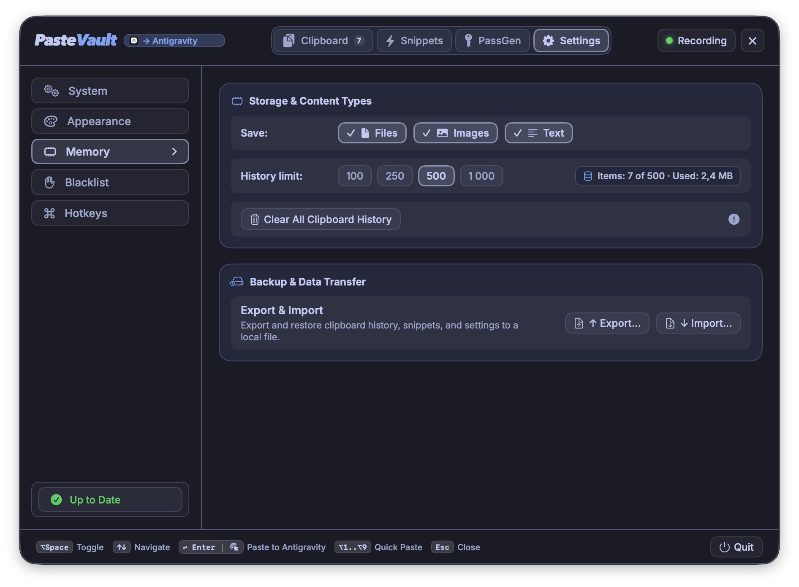<br />
      <sub><strong>10. Память и перенос данных</strong> — лимиты истории и зашифрованный экспорт/импорт</sub>
    </td>
  </tr>
</table>
