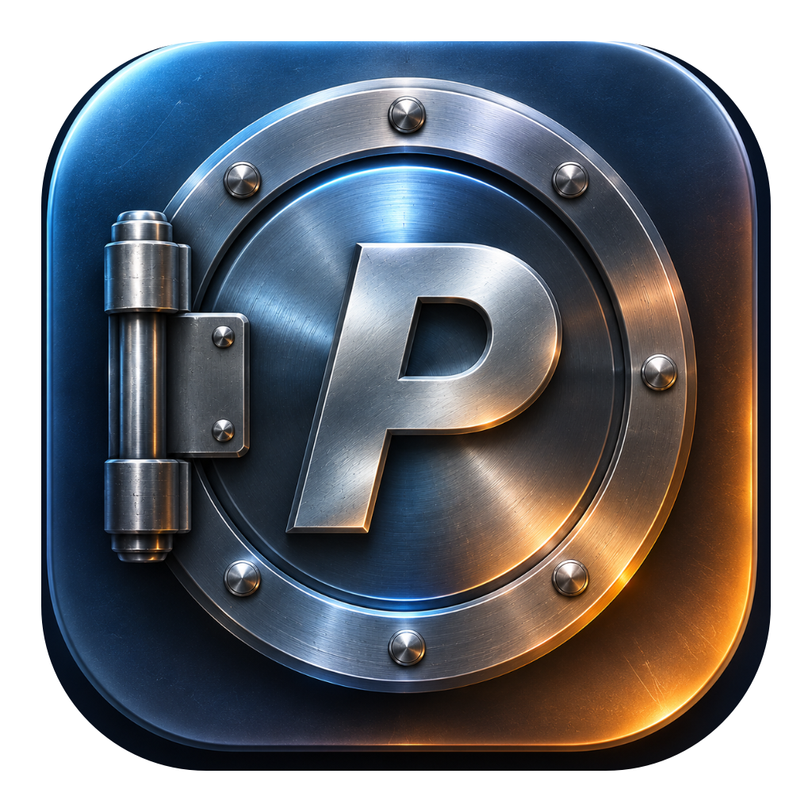

<div align="center">
  
  <h1>PasteVault</h1>
  <p><b>Умный менеджер буфера обмена, редактор скриншотов, быстрый экспорт в файл, офлайн OCR, сейф паролей с таймером и хранилище шаблонов для macOS.</b></p>

  <p>
    <a href="../../releases/latest"></a>
    
    
    
  </p>

  <p>
    <b>🇷🇺 Русский</b> &nbsp;|&nbsp; <a href="README.en.md">🇬🇧 English</a> &nbsp;|&nbsp; <a href="../../releases/latest">⬇️ Скачать v1.0.1 (.dmg)</a>
  </p>
</div>

---

### ✨ Возможности

* **Умный буфер обмена с подсветкой поиска** — мгновенный полнотекстовый поиск (SQLite FTS5) с цветовой подсветкой найденных совпадений прямо в тексте карточек; фильтрация по типам (Текст, Код, Ссылки, Картинки, Цвета `#HEX`, Пароли, Закреплённые); закрепление (`Pin`), редактирование текста, умные трансформации (JSON, Base64, регистр, очистка пробелов) и автовставка в активное окно.
* **Быстрый экспорт текста и кода в файл** — экспорт карточки в один клик прямо из правого инспектора в 9 популярных форматов: `.docx` (документ Microsoft Word), `.txt`, `.conf`, `.json`, `.swift`, `.py`, `.md`, `.sh`, `.js` с умным авто-подбором имени файла, подсветкой рекомендуемого формата и нативным сохранением через `NSSavePanel` поверх окна.
* **Встроенный редактор скриншотов и изображений** — полноценная разметка скопированных картинок в один клик: стрелки, прямоугольники, эллипсы, текст, маркер, размытие/пикселизация секретов (Blur), автонумерация шагов (`1, 2, 3`), лупа (Magnifier), кадрирование (Crop), масштабирование, сохранение в `.png` и поддержка горячих клавиш.
* **Офлайн распознавание текста на фото (OCR)** — мгновенное извлечение русского и английского текста со скриншотов и фотографий через нативный фреймворк Apple Vision без интернета.
* **Сейф паролей, автодетектор секретов и таймер самоуничтожения** — автоматическое распознавание паролей, API-ключей и токенов, маскировка точками (`••••`), таймер автоудаления (от 10 сек до 6 мин) с кнопками паузы и остановки, а также встроенный криптостойкий генератор паролей (8–48 символов) и пассфраз (CSPRNG) с оценкой надёжности.
* **Быстрые фрагменты (Сниппеты)** — хранение шаблонов текста, команд и подписей по категориям с закреплением важных карточек (`Pin`), защитой закреплённых при очистке, приоритетным поиском с подсветкой совпадений и автоподстановкой динамических тегов `{{date}}`, `{{time}}` и `{{clipboard}}`.
* **Резервное копирование и перенос данных (`.pastevaultbackup`)** — удобный выборочный экспорт и безопасный импорт данных без дубликатов: вся история буфера или только закреплённые записи, все или только закреплённые фрагменты, а также настройки, горячие клавиши и Чёрный список приложений.
* **10 тем оформления, 6 шрифтов и Audio-Taptic отклик** — 5 стеклянных тем *Liquid Glass* (с настройкой прозрачности окна), 5 матовых тем, 6 встроенных кириллических шрифтов и деликатный звуковой/тактильный отклик.
* **100% локально и приватно (Zero-Telemetry)** — все данные буфера обмена, пароли, база SQLite и распознавание OCR обрабатываются строго на вашем Mac. Приложение выходит в сеть исключительно для проверки обновлений на GitHub Releases по вашему запросу или при включенной опции в настройках. Доступны режим «Инкогнито» и гибкий Чёрный список приложений.

---

### 📦 Установка

1. Скачайте **`PasteVault_v1.0.1_Universal.dmg`** в разделе [**Releases**](../../releases/latest) (работает на macOS 14 и новее, на процессорах Apple Silicon (серия M) и Intel), откройте образ и перетащите **`Paste Vault.app`** в папку **`Applications`**.
2. При первом запуске снимите предупреждение macOS Gatekeeper любым из двух способов:
   * **Способ 1 (Через интерфейс macOS):** Попробуйте открыть `Paste Vault.app` → когда появится окно Gatekeeper, нажмите «Готово» → откройте **Системные настройки → Конфиденциальность и безопасность**, прокрутите вниз и нажмите **«Всё равно открыть» (`Open Anyway`)**.
   * **Способ 2 (За 1 секунду через Терминал):**
     ```bash
     xattr -cr "/Applications/Paste Vault.app" && open "/Applications/Paste Vault.app"
     ```
3. Включите галочку **Paste Vault** в *Системные настройки → Конфиденциальность и безопасность → Универсальный доступ (Accessibility)* для работы авто-вставки.

---

### ⌨️ Горячие клавиши

#### Основные горячие клавиши
| Комбинация | Действие |
| :--- | :--- |
| **`⌘ + Shift + V`** *(или `⌥ + Space`)* | Открыть / скрыть окно PasteVault поверх всех окон *(настраивается в Настройках)* |
| **`⏎` (Enter)** | Вставить выбранный элемент в активное окно |
| **`Shift + ⏎`** | Вставить как чистый текст без форматирования (`Plain Text`) |
| **`⌥ + 1` … `⌥ + 9`** | Мгновенно вставить элемент №1…9 из списка |
| **`⌥ + P`** | Закрепить / открепить карточку (`Pin`) |

#### Инструменты редактора скриншотов
В окне аннотации изображений доступны быстрые клавиши:
* `A` — Стрелка &nbsp;|&nbsp; `R` — Рамка / Прямоугольник &nbsp;|&nbsp; `T` — Текст &nbsp;|&nbsp; `B` — Размытие (Blur) &nbsp;|&nbsp; `N` — Нумерация шагов (`1, 2, 3`) &nbsp;|&nbsp; `M` — Лупа (Magnifier) &nbsp;|&nbsp; `⌘ + Z` — Отмена &nbsp;|&nbsp; `⌘ + S` — Сохранить

---

### 💻 Системные требования

* **macOS:** 14.0 или новее
* **Архитектура:** Universal Binary (Apple Silicon и Intel)
* **Язык интерфейса:** Русский / English (переключается в Настройках)
* **Локальная база:** `~/Library/Application Support/PasteVault/` (100% офлайн, SQLite)

<div align="center">
  <sub>Made with ❤️ for macOS • <b>PasteVault v1.0.1</b></sub>
</div>
